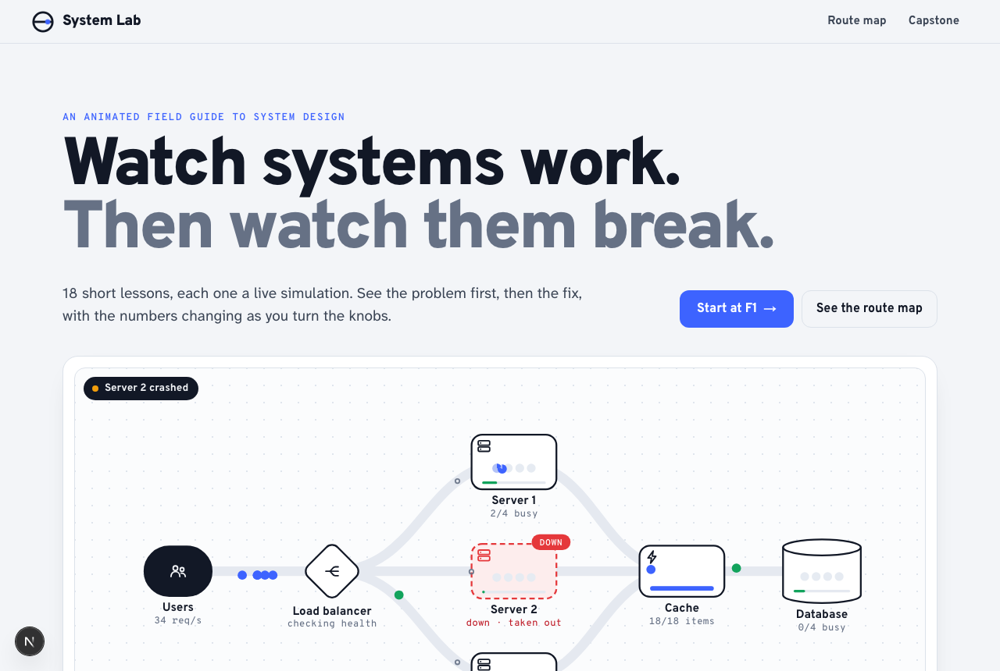
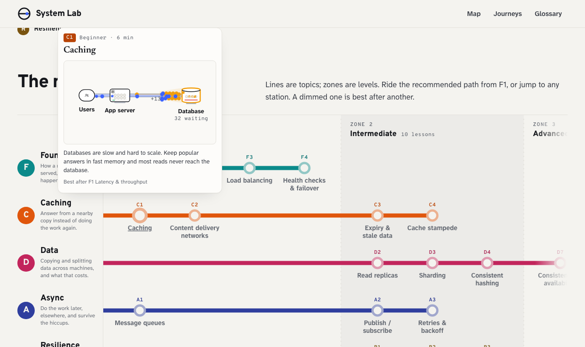
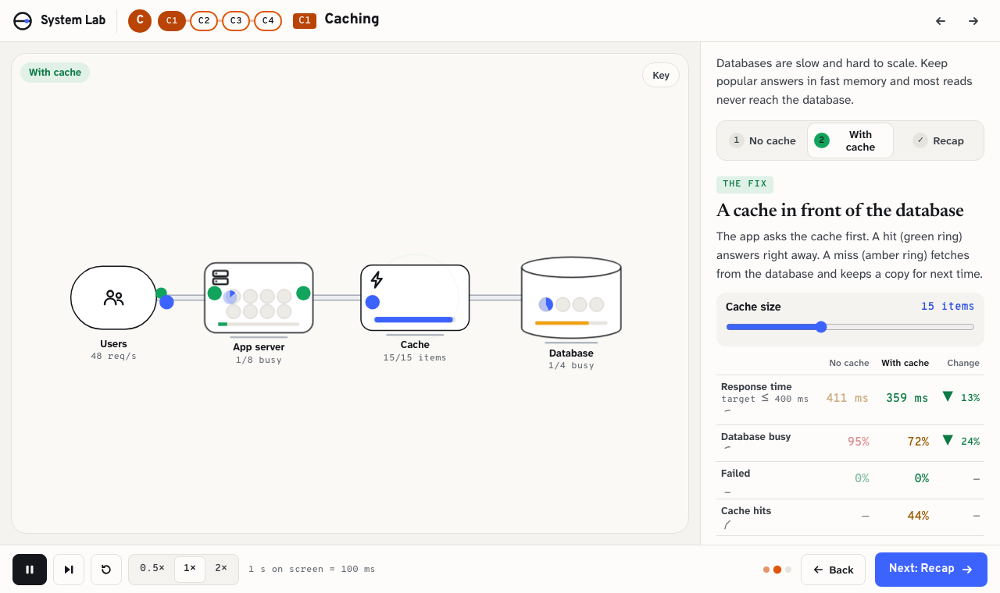
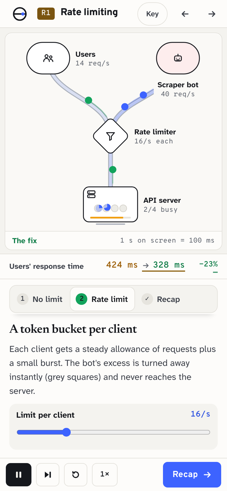
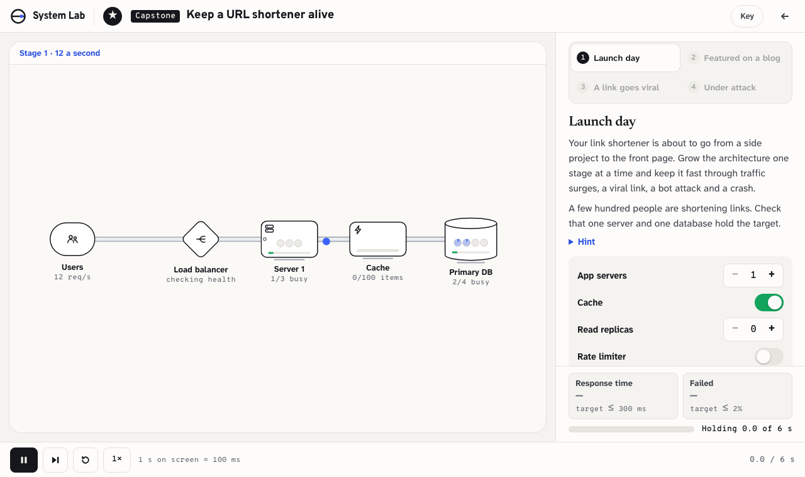

# System Lab

**Watch systems work. Then watch them break.** System Lab is an animated field guide to system design. Each lesson is a live simulation: requests flow as dots, caches hit and miss, queues fill, servers crash and recover, and the metrics change as you turn the knobs.

Live at **[sys-design-learning.vercel.app](https://sys-design-learning.vercel.app)**. Made with care by [Aman](https://amankeshri.com).



## The route

The course is a transit map: 57 lessons on seven lines, plus nine journeys. Lines are topics, and three fare zones are the levels: beginner, intermediate and advanced.

| Line | Stations |
|---|---|
| **N · Networking** (16) | N1 A request and a response · N2 Acknowledgements · N3 Latency vs bandwidth · N4 Handshakes and keep-alive · N5 DNS · N6 Windows and flow control · N7 Long polling, SSE and WebSockets · N8 Timeouts and deadline propagation · N9 Congestion control · N10 Head-of-line blocking and multiplexing · N11 L4 vs L7 · N12 Heartbeats · N13 Pipelining and batching · N14 At-most-once, at-least-once, exactly-once · N15 Backpressure · N16 Nearest region and failover |
| **F · Foundations** (6) | F1 Latency & throughput · F2 Scaling up vs out · F3 Load balancing · F4 Health checks & failover · F5 Stateless servers and sessions · F6 Nines, SLOs and error budgets |
| **C · Caching** (6) | C1 Caching · C2 CDNs · C3 Expiry & stale data · C4 Cache stampede · C5 Misses that never hit · C6 Write-through, write-behind, cache-aside |
| **D · Data** (10) | D1 Indexes · D2 Read replicas · D3 Sharding · D4 Consistent hashing · D5 Connection pools · D6 Primary failover · D7 Consistency vs availability · D8 Quorum reads and writes · D9 Leader election · D10 Locks and double booking |
| **A · Async** (9) | A1 Message queues · A2 Publish / subscribe · A3 Retries & backoff · A4 Idempotency keys · A5 Dead-letter queues · A6 The outbox pattern · A7 Partitions and consumer groups · A8 Windows and aggregation · A9 Sagas |
| **R · Resilience** (8) | R1 Rate limiting · R2 Circuit breakers · R3 Autoscaling · R4 Load shedding · R5 Bulkheads · R6 Cascading failures · R7 Cold caches and thundering herds · R8 Hedged requests |
| **O · Operating** (2) | O1 Canary rollouts · O2 Graceful shutdown and draining |
| **★ Journeys** (9) | S0 Keep a URL shortener alive · S1 Crawl the web · S2 Serve a premiere to the world · S3 Keep a chat live · S4 Sell 1,000 seats to 100,000 people · S5 Match a rider to the nearest driver · S6 Build a news feed · S7 Charge exactly once · S8 Count a billion clicks |

One recommended path interleaves the lines, and every lesson's **Next stop** follows it. An interview fast lane picks out the canon.

The home page opens on a live scene whose parts explain themselves when tapped, and a first ride: five short stops, about twenty minutes, from a request and a response to finding a server. Below, the map draws the zones as bands. Hover or focus a station to see its card with the lesson running; a dimmed station is best seen after another. On a phone the map becomes a board you can filter by level and search by any name a concept goes by ("thundering herd", "429", "Kafka").



## A lesson

Every lesson fits on one screen, so you never scroll to find the simulation and then scroll back to read about it:

- **Stage.** The live scene fills most of the screen. A strip along its top edge carries the narration and names events as they happen: a crash, a stall, a broken link.
- **Side panel.** The steps, as tabs:
  - **The problem**: the scene without the idea.
  - **The fix**: the same scene and the same traffic, with the idea added.
  - **Recap**: one or two questions, the rule in a few words, when to use it, the catch, where you'll see it and, for advanced lessons, what to say in an interview.
- **Comparison table.** Pinned under the steps, a live **Without | With | Change** table measures both worlds side by side. They run in lockstep, and a fault button hits both.
- **Dock.** Playback, the speed and what it means ("1 s on screen = 100 ms"), **Follow one** and the single **Next** button. The dot **Key** opens from the top bar.
- **Phones.** The stage stays on top with the lesson's headline number under it, the panel is the only part that scrolls, and the dock sits at the bottom.

A lesson teaches by watching:

- **Parts build in** along the flow, each with one line on what it does and a number.
- **Beats** narrate what to watch, one thing at a time, beside what they point at; their numbers are measured live.
- **A prediction** asks you to commit before the fix, and the engine shows whether you were right.
- **You cause the failure.** The ⚡ button (crash a cache, open a sale, cut a link) plays the fault in both worlds at once.
- **Follow one** request through every hop, with a wait/work/wire timeline.
- **Glossary terms** are named once, by the beat that shows them, and open a short definition with a "Show me".
- **Part cards:** tap any station's name to see what it is, what it does in this scene, what it is doing right now, how to read its drawing, and the lesson that teaches it.





## A journey

In a journey you grow the architecture yourself. In the flash sale you add a seat-map cache, compare-and-set and a waiting room; in the chat, servers, held connections and heartbeats. Each stage raises the traffic or breaks something, and unlocks once your design holds its targets long enough. Every design has a monthly price, so the last stage asks whether a cheaper one would do. All nine run on one story player; a new journey is data.



## My system

**[/my-system](https://sys-design-learning.vercel.app/my-system)** puts your own system on the stage. Start from a system like yours (a web app, a shop, background jobs, event-driven orders, video to the world, a crawler, a write-heavy app, a social feed) and change it: parts, copies, how busy it is, what calls what. Crash any part or slow it down, and **What breaks** crashes each part in turn on a copy of your system and says what happens, with the usual fix; **Try the fix** runs it beside yours on the same traffic. **Explain like I'm new** walks the parts in the order a request meets them. It all runs in your browser: systems are kept there, and **Share** copies a link that carries the whole system after its `#`.

## Your progress

**[/progress](https://sys-design-learning.vercel.app/progress)** shows what you've done: lessons opened and watched to the end, predictions and checks you got right, journeys finished, each line station by station, and the latest things you did. It is kept only in your browser (no account, nothing sent anywhere), and you can download it or clear it. Each lesson's Recap ends by asking whether it landed, and what got in the way if not.

## How to read a scene

- **Dots are requests.** Cobalt: in flight. Amber: running late. Green: answered. Violet donut: stale data. Slate square: turned away. Red diamond: failed. Hollow red: the user gave up.
- **Marks that extend them keep their meaning.** A rail glows with its traffic; a waiting line sits on an amber wedge; a copy (a replica's, a topic's, a saved row) travels as a small hollow square; news pushed down an open connection is a small cobalt dot; handshakes, heartbeats and votes are small grey rings; a message lost on its link leaves a red cross.
- **Things that aren't requests are ink.** An evicted cache entry, or a count too late for its window, falls as a flat chip.
- **Shapes are parts of the system.** Slot sockets inside a server are its workers (hollow: stuck waiting); a cache's bar shows how full it is; rings mark a station changing state.
- Scenes run slower than the milliseconds in the metrics (about 10×), so you can follow a single request. The dock says how much.

## Run it

You need Node.js 22 or newer.

```bash
npm ci
npm run dev            # http://127.0.0.1:3000
```

## Check it

```bash
npm run typecheck
npm test               # engine invariants and hooks, every lesson's claim, beats, catalog
npm run build
npx playwright install chromium
npm run test:browser   # four screen sizes: fit, labels, motion, controls; then frame budgets with the CPU slowed 4×
npm run tune           # each figure's metrics over a simulated run (--beats, --json, --line=, --level=)
npm run stats -- <export.json>   # per-lesson tuning numbers from records downloaded on /progress
```

`npm test` asserts that, for every lesson, the fix beats the problem on its headline metric, that every beat fires in a learner's run and every prediction comes true, and that a problem and its fix see the same traffic. A tuning change that would make an animation teach something false fails the build. For a journey, each stage's own design must clear it and the previous stage's must not.

To add a lesson, give it a planned entry in the catalog, then `npm run new-lesson -- <slug>`: it writes the skeleton and registers it, and the tests fail until it is written. The authoring rules are in [docs/plan-v3.md §8](docs/plan-v3.md) and [CLAUDE.md](CLAUDE.md).

## How it works

```text
src/
  app/                    Next.js App Router: home, /learn/[slug] (static), /glossary, 404
  components/
    shell.tsx             the one-screen layout (bar · stage | panel · dock) and the beat strip
    lesson-page.tsx       a lesson or story page: its own player and scenes, loaded on demand
    player.tsx            the lesson player; story-player.tsx, the stage-by-stage player for journeys
    stage.tsx             SVG stations underneath, a canvas of moving requests on top; picks a wide,
                          compact (landscape phone) or tall (portrait phone) layout to fit its box
    stage-draw.ts         the canvas: requests batched by look, trails, queue pressure, effects
    live.tsx              lockstep worlds and the animation loop, the comparison table, transport
    beats.tsx, follow.tsx the narration (beats, callouts, cards) and following one request
    term.tsx              glossary terms in text; each page is sent only the terms it uses
    route-map.tsx         the transit map and the phone board; journeys.tsx, home-start.tsx the rest of home
  lib/
    sim/engine/           the deterministic simulator, one module per concern (below)
    sim/metrics.ts        sliding-window metrics, their tones and their plain-words explanations
    sim/layout.ts         layout coordinates → a frame fitted to the box, labels placed clear of each other
    lessons/catalog.ts    every lesson and journey: codes, lines, levels, prerequisites, the path
    lessons/words.ts      each entry's one-line why and its search tags
    lessons/scenes/       one file per lesson: pure build(values) → SceneSpec, and its narration as data
    lessons/stories/      one file per journey: a StoryDef
    glossary.ts           the course's vocabulary
tests/                    node:test engine, hook, lesson and catalog tests; Playwright browser tests
```

- **The engine** is deterministic: a fixed 2 ms tick, seeded per-node random streams, no I/O. Requests travel out through the scene's stations and retrace their path back. `sim.ts` holds the state and the loop; each concern is a module that attaches its methods to the simulation:
  - **core:** clients (timeouts, retries with backoff, jitter and budgets), balancers (round robin to consistent hashing, health checks, autoscaling, canaries), servers (workers, lines, calls, call timeouts, breakers, shedding, bulkheads), caches, databases (replicas, regions, partitions), queues, topics and limiters; lossy links whose losses are a hash of what crosses, so a problem and its fix lose the same messages.
  - **messages and delivery:** idempotency, acks, visibility timeouts and dead letters, backpressure, the outbox.
  - **connections and real time:** handshakes and keep-alive, sending windows and AIMD, L4 and L7 balancing, held connections and polling, heartbeats, failover.
  - **coordination:** scatter-gather and hedging, quorums, leader election, locks and compare-and-set, sagas.
  - **streams and durability:** event-time windows that wait for late events, and cache write modes whose unsaved writes die in a crash.
  - A timed-out request keeps running as a ghost. That wasted work is what makes retry storms possible.
- **Live knobs.** Changing a knob rebuilds the scene spec, and `sim.reconfigure(spec)` patches the running simulation in place.
- **Rendering.** Only on-screen scenes animate. Stations are React SVG, redrawn about 11 times a second; requests, trails and effects are canvas, drawn every frame. Stage text stays at its CSS size: the frame is fitted around it. Switching steps keeps shared parts, glides moved ones and fades the rest.
- **Weight.** A page loads one player and one lesson's scenes; the glossary stays on the server, which sends each page only its terms.
- **Reduced motion.** Nothing autoplays. Figures open on a settled still frame, and Play and Step are always available.

See [docs/plan-v3.md](docs/plan-v3.md) for the plan, each milestone's decisions and its gates.

## Deploy

Vercel builds every push to `main`. No environment variables or external services are needed.
